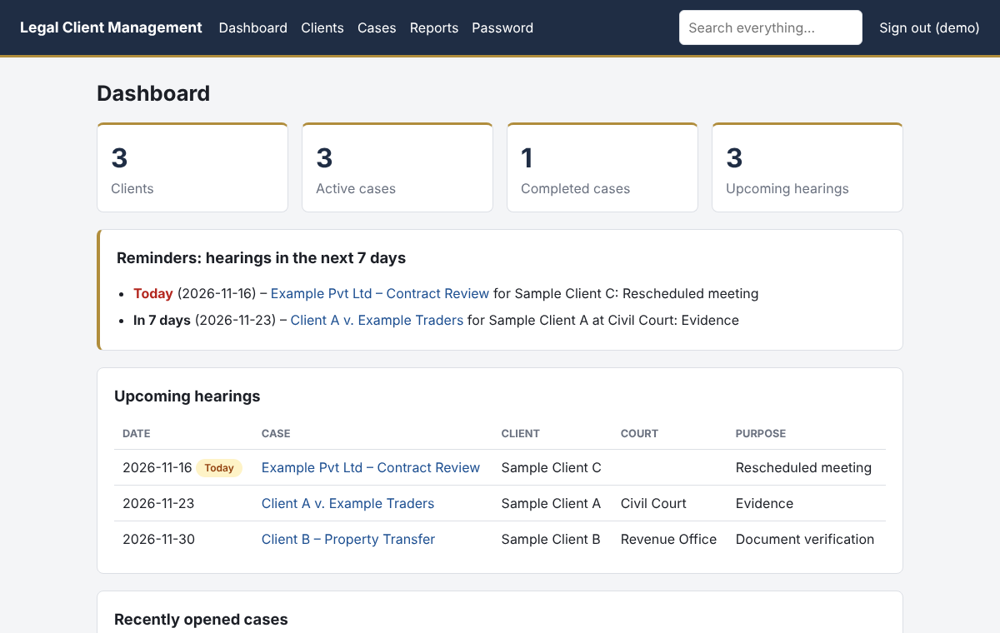
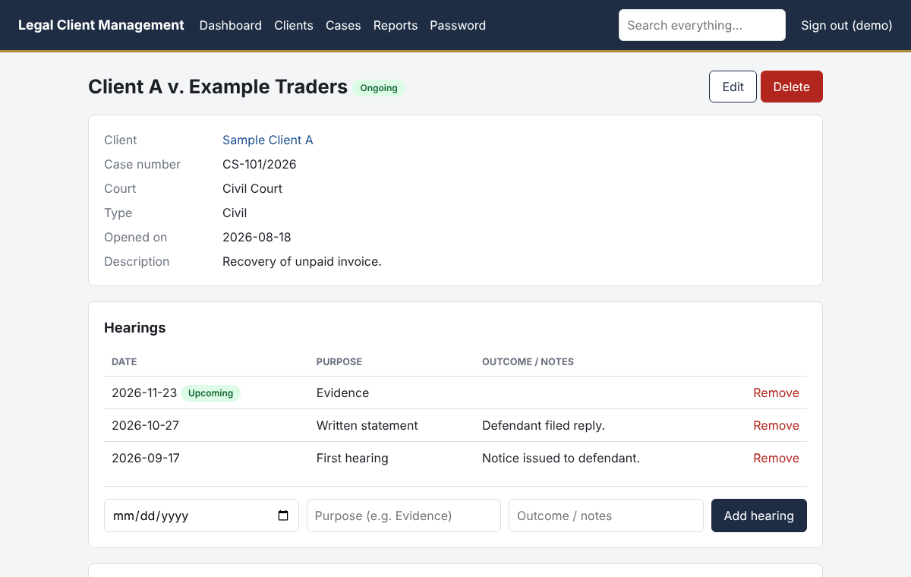
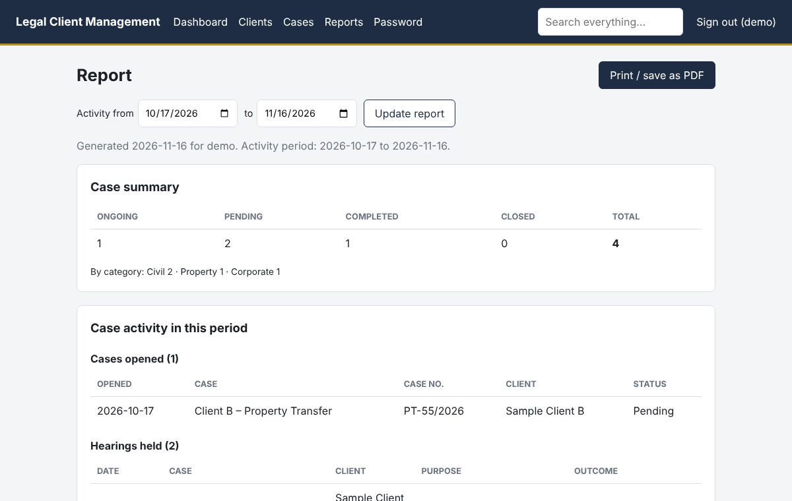
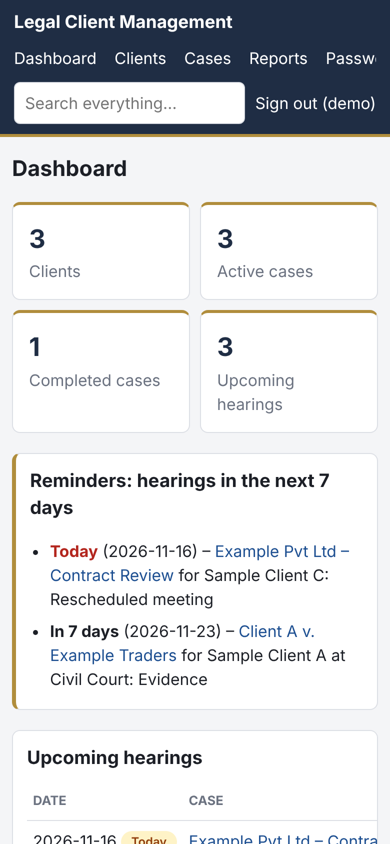

# Legal Client Management System

[](https://github.com/AhmadKhichi123/Legal-/actions/workflows/tests.yml)

A web app for lawyers that keeps clients, cases, hearing dates and legal
documents in one secure, searchable place. It runs in any browser and can be
installed as an app on Windows, Mac, Android, iPhone and iPad.

It was built as an IB Computer Science project for a practising lawyer in
Pakistan and his colleagues, who were managing their records in paper files.



## Features

- **Separate lawyer accounts.** Each lawyer registers and sees only their own records.
- **Clients:** name, CNIC (format checked), phone, email, address and notes.
- **Cases:** case number, court, category and status (Ongoing, Pending, Completed, Closed).
- **Hearings:** dates, purpose and outcome, with reminders for the next 7 days.
- **Documents:** upload PDF, Word, Excel, image and text files (up to 20 MB) and download them later.
- **Search** across clients, cases and documents.
- **Filters** by client, status, category and hearing date; a case history view.
- **Reports:** a printable summary for any period (print or save as PDF).
- **Works on phones:** the layout adapts to small screens, and the site can be installed as an app.
- **Security:** hashed passwords, HTTPS, protection against SQL injection and forged forms.

| Case page | Report | Phone |
| --- | --- | --- |
|  |  |  |

All data in the screenshots is fictional.

## Run it on your computer

1. Install [Python](https://www.python.org/downloads/) 3.10 or newer (on Windows, tick **Add Python to PATH**).
2. Download this project (green **Code** button → **Download ZIP**) and unzip it.
3. Open a terminal in the project folder and run:

   ```
   pip install -r requirements.txt
   python app.py
   ```

4. Open <https://127.0.0.1:5000>. The browser warns about the certificate the
   first time because the app creates its own; choose **Advanced → Proceed**.
5. Choose **Create an account**.

Options:

| Command | What it does |
| --- | --- |
| `python app.py --demo` | Adds a demo account (`demo` / `demo12345`) with fictional sample records |
| `python app.py --network` | Lets other computers on the same Wi-Fi open the app; it prints the address |
| `python app.py --port 8000` | Uses a different port |

## Put it online (works on every device)

To use the app from any phone, tablet or computer, and to install it as an
app, it must be hosted online with HTTPS. These steps use
[PythonAnywhere](https://www.pythonanywhere.com/), which has a free plan:

1. Create a PythonAnywhere account.
2. Open a **Bash console** and run (use your own GitHub address):

   ```
   git clone https://github.com/AhmadKhichi123/Legal-.git
   cd Legal-
   pip install --user -r requirements.txt
   ```

3. On the **Web** tab, choose **Add a new web app → Manual configuration**, and the newest Python version.
4. Open the **WSGI configuration file** link, delete everything in it, and paste:

   ```python
   import sys
   sys.path.insert(0, "/home/YOUR-USERNAME/Legal-")
   from wsgi import application
   ```

5. On the Web tab, turn on **Force HTTPS** and click **Reload**.
6. Open `https://YOUR-USERNAME.pythonanywhere.com` and create an account.

To update the online copy after changing the code on GitHub: in the Bash
console run `git pull` inside the project folder, then click **Reload**.

**Use real client records online only if you accept that they are stored on
the hosting company's servers.** For trying it out, use the demo data.

## Install it as an app

Once the app is online with HTTPS:

| Device | How to install |
| --- | --- |
| Windows, Mac, Chromebook (Chrome or Edge) | Click the gold **Install app** button, or the install icon in the address bar |
| Android (Chrome) | Tap **Install app**, or menu → **Add to Home screen** |
| iPhone, iPad (Safari) | Tap **Share → Add to Home Screen** |

The installed app opens in its own window with its own icon. It needs an
internet connection: records are never stored on the device, because they are
confidential.

## Offline options

- **Single file:** `python tools/make_single_file.py` creates `dist/legal_cms.py`,
  the whole app in one file that can be double-clicked on a computer with Python.
- **Windows program:** double-click `tools/build_windows_app.bat` on Windows to create
  `dist/LegalCMS.exe`, which runs without Python installed.

## Tests

```
python test_app.py     # 60 automated checks covering every feature
python perf_test.py    # speed test with 500 clients, 2,000 cases and 6,000 hearings
```

Both use a temporary folder, so real records are never touched.

## Project structure

| Path | Contents |
| --- | --- |
| `app.py` | All Python code: database, pages, security, reports, demo data, HTTPS |
| `wsgi.py` | Entry point for hosting online |
| `templates/` | HTML pages |
| `static/` | Stylesheet, app icons, and the files that make the site installable |
| `test_app.py`, `perf_test.py` | Tests |
| `tools/` | Single-file and Windows builders |
| `data/` | Created on first run: database, uploaded documents, keys (never uploaded to GitHub) |

## Backup

Copy the `data` folder. It holds every record and uploaded document.

## Built with

Python, [Flask](https://flask.palletsprojects.com/), SQLite, HTML and CSS.
Developed with the help of an AI assistant (Claude, by Anthropic).
